<p align="center">
  
</p>

<h1 align="center">Lumen Atlas</h1>

<p align="center">
  A client-side minimap and world map for Minecraft <b>26.3</b> on <b>Fabric</b> and <b>NeoForge</b>,<br>
  with automatic structure markers, a full waypoint system and a built-in, offline seed map.
</p>

<p align="center">
  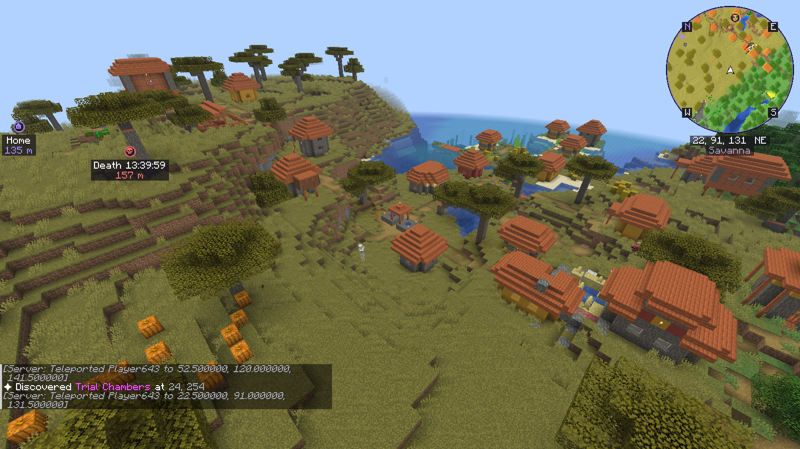
  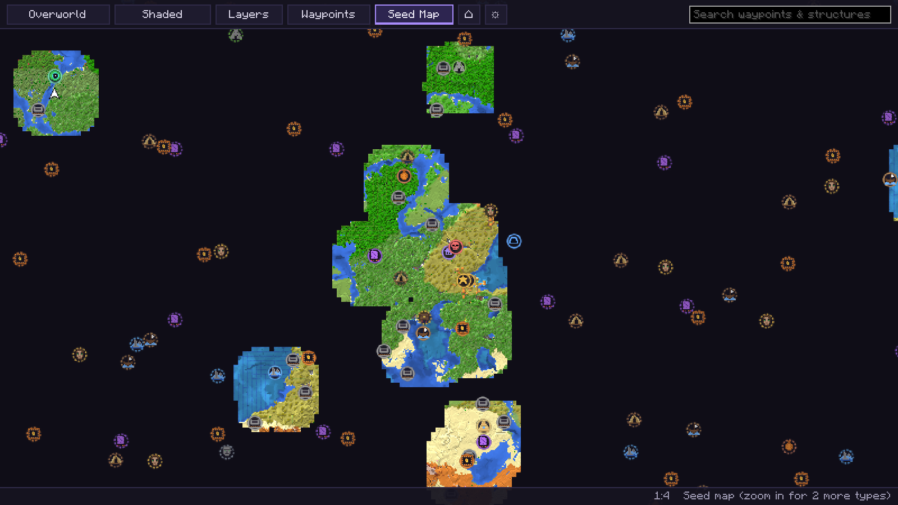
</p>

---

## Features

**Minimap**
* Real-time map of the terrain around you, built from the chunks your client actually receives.
* Round or square, rotating with your view or north-up, 9 sizes, 4 corners, adjustable opacity, 5 zoom levels.
* Four map views: shaded relief, flat, topographic (height bands and contour lines) and biomes.
* Automatic cave view underground and in the Nether (shows the floor around you instead of the surface).
* Coordinates, facing direction, biome, compass letters, other players, optional hostile and passive mobs.
* Rendered at the exact pixel size of your screen, so it stays sharp at every GUI scale.

**World map** (press <kbd>M</kbd>)
* Everything you explored, saved per world, per server and per dimension (Overworld, Nether, End).
* Smooth zooming around the cursor, dragging, keyboard panning, three levels of detail for huge maps.
* Search for waypoints, discovered structures and seed-map predictions.
* Hover any icon for its name, coordinates and distance; right-click for actions (create waypoint, hide marker,
  copy coordinates...).
* Layer panel to switch every structure type, predictions, waypoints and the grid on or off.
* Shows Nether/Overworld coordinate conversion for the cursor.

**Automatic structure detection** – see [docs/STRUCTURES.md](docs/STRUCTURES.md)
* Villages, strongholds, ancient cities, trial chambers, woodland mansions, pillager outposts, desert pyramids,
  jungle temples, ocean monuments, shipwrecks, nether fortresses, bastions, end cities, mineshafts, ruined portals,
  igloos, witch huts, ocean ruins, trail ruins, amethyst geodes, monster dungeons and nether fossils.
* Each gets its own icon on the minimap and the world map, stays saved, and can become a waypoint with one click.
* Several detections of the same structure are merged into one marker near its center.

**Seed map** (Chunkbase-style, but inside the game and offline)
* Predicts where structures are from the world seed – using **Minecraft's own structure placement code**, not a
  re-implementation, so predictions follow this exact game version.
* Singleplayer: uses the world's real seed automatically. Servers and Realms: enter the seed if you know it.
* Predicted structures have **dashed** icons; once you actually find the structure, the solid "discovered" icon
  replaces the prediction.

**Waypoints**
* Create, edit, delete, hide; 14 colors plus any hex color, 10 icons.
* Shown on the minimap (with edge arrows when far away), on the world map and in the 3D world with distance.
* Automatic death waypoints (keeps the last few).
* Export to and import from JSON files (or drop a file onto the waypoint list).

**Design**
* Own dark theme with soft violet accents, own icons (all original pixel art, see `tools/make_icons.py`).
* Every setting is available in game (press <kbd>O</kbd>), every key can be rebound.

## Screenshots

All screenshots are real, taken by the automated in-game test (`runSelfTest`) on Fabric for Minecraft 26.3
(world seed `20261031`).

| | |
|---|---|
|  <br> Round, rotating minimap above a village. The villager icon was placed automatically. | 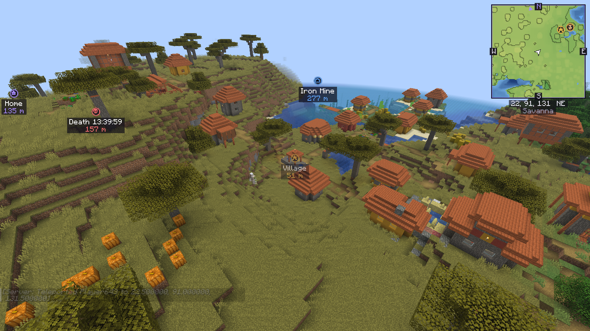 <br> Square, north-up minimap in topographic view. |
| 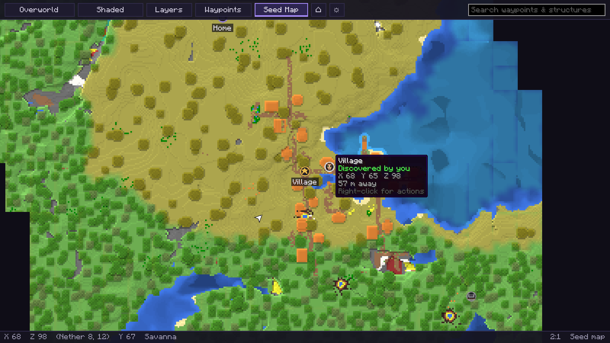 <br> World map zoomed into the discovered village, with the hover tooltip. |  <br> Overview with discovered structures, waypoints and dashed seed-map predictions. |
| 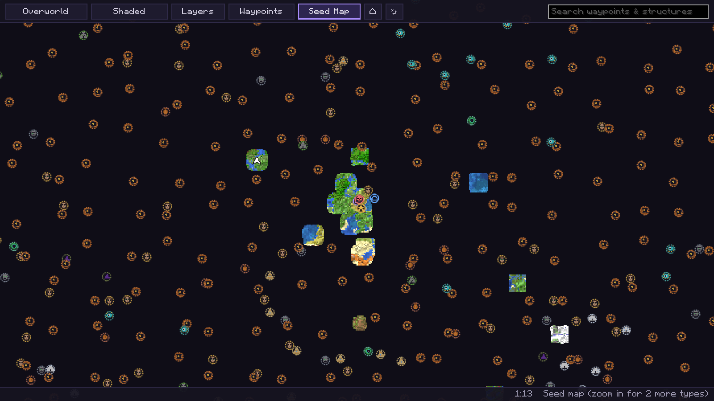 <br> Zoomed out: structures predicted from the seed. | 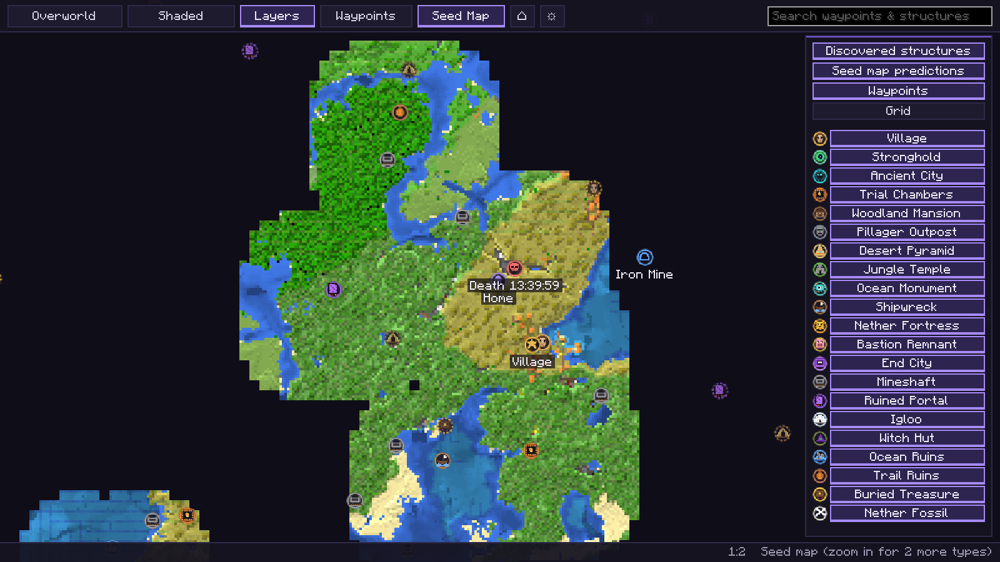 <br> The layer panel: every structure type can be switched on or off. |
| 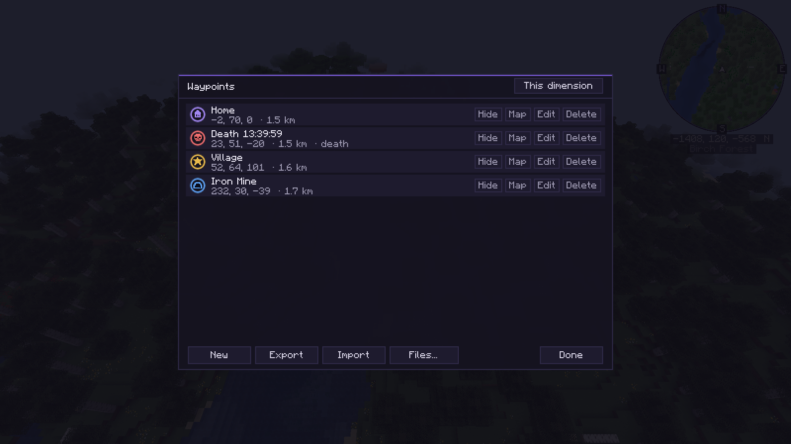 <br> Waypoint list with home, village, death and mine waypoints. | 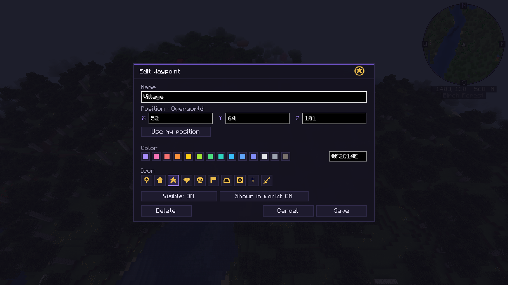 <br> Waypoint editor: name, position, color, icon. |
| 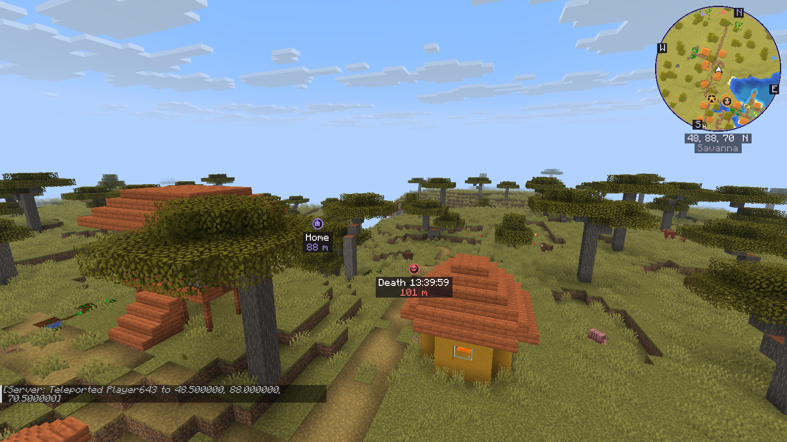 <br> Waypoints in the 3D world with distance. | 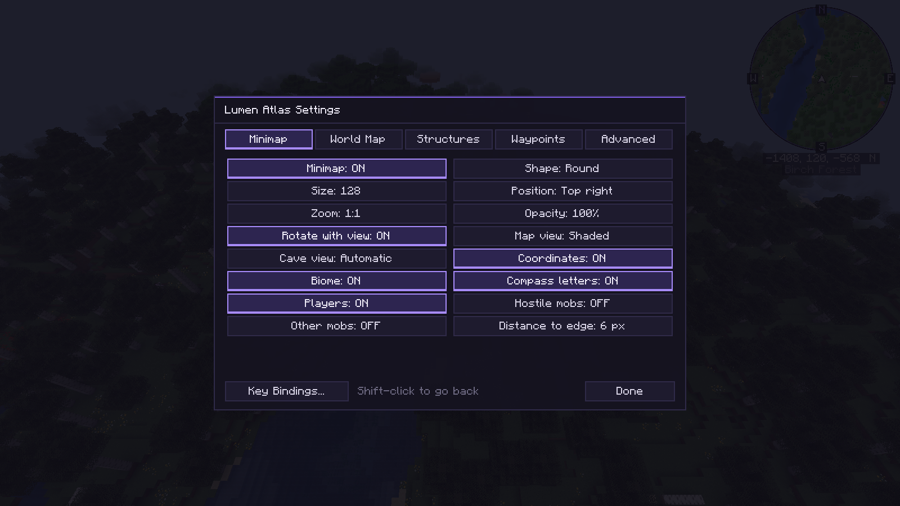 <br> In-game settings. |
| 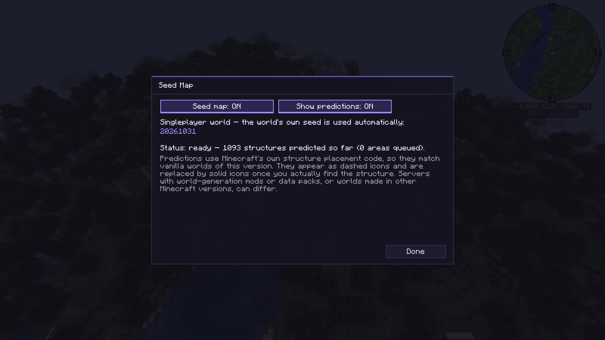 <br> Seed map settings (singleplayer seed shown). | 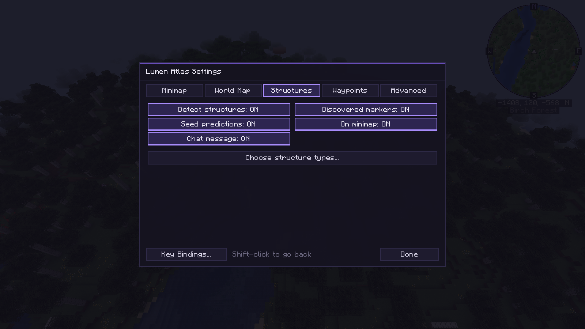 <br> Structure settings. |
| 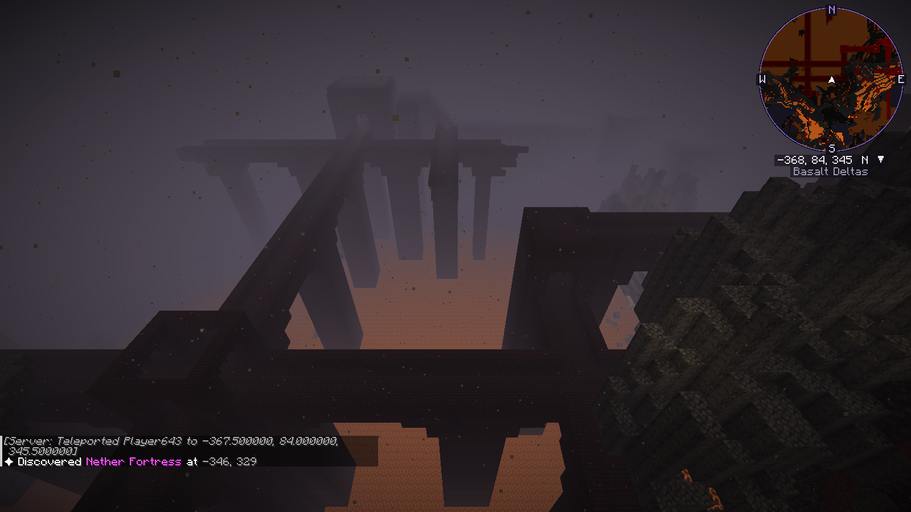 <br> Nether: automatic cave view and a freshly detected fortress. | 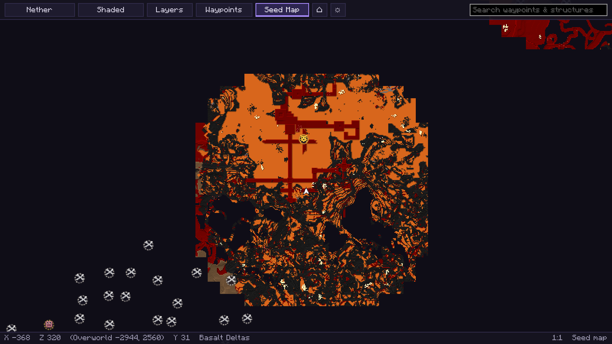 <br> Nether world map with the fortress and predicted nether fossils. |

## Supported versions

| Minecraft | Fabric | NeoForge | Java |
|---|---|---|---|
| 26.3 | Fabric Loader ≥ 0.20.1 with Fabric API 0.165.0+26.3 | 26.3.0.100 or newer | 25 |

26.3 is the current release as of October 2026. The build is set up for several Minecraft versions side by side
(`versions/<mc>/`), see [docs/ARCHITECTURE.md](docs/ARCHITECTURE.md#porting-to-a-new-minecraft-version).

## Installation

**Fabric**
1. Install [Fabric Loader](https://fabricmc.net/use/) for Minecraft 26.3.
2. Put [Fabric API](https://modrinth.com/mod/fabric-api) and `lumenatlas-fabric-mc26.3-<version>.jar` into
   `.minecraft/mods`.

**NeoForge**
1. Install [NeoForge](https://neoforged.net/) 26.3.0.100 or newer.
2. Put `lumenatlas-neoforge-mc26.3-<version>.jar` into `.minecraft/mods`.

The mod is **client-only**. Do not install it on servers; it works on any server (vanilla, modded, Realms)
without server-side support.

## Key bindings

| Key | Action |
|---|---|
| <kbd>M</kbd> | Open the world map |
| <kbd>U</kbd> | Waypoint list |
| <kbd>B</kbd> | New waypoint at your position |
| <kbd>O</kbd> | Settings |
| <kbd>N</kbd> | Show / hide the minimap |
| <kbd>=</kbd> / <kbd>-</kbd> | Minimap zoom in / out |
| *(unbound)* | Cycle minimap view |

All keys can be changed in *Options → Controls → Key Binds → Lumen Atlas*.

On the world map: drag to pan, scroll to zoom, <kbd>Space</kbd> centers on you, <kbd>W A S D</kbd> / arrow keys pan,
<kbd>+</kbd>/<kbd>-</kbd> zoom, right-click for actions, <kbd>M</kbd> or <kbd>Esc</kbd> closes.

## How structure detection works

Servers never send the client a list of structures. Lumen Atlas looks at what the client does receive:

* **Blocks** of every loaded chunk. Some blocks only generate in one structure and cannot be obtained in survival
  (end portal frames → stronghold, reinforced deepslate → ancient city, trial spawners/vaults → trial chambers,
  gilded blackstone → bastion, budding amethyst → geode). Others are recognized by typical combinations
  (a bell → village, blue + orange terracotta → desert pyramid, nether brick fences → fortress...).
* **Entities** near you: elder guardians, blazes, piglin brutes, shulkers, groups of villagers, evokers in dark
  forests, chest minecarts deep underground.

Every chunk is checked once. A palette check skips most chunk sections in microseconds, so detection has no
noticeable cost. The complete rule list, with how reliable each rule is, is in
[docs/STRUCTURES.md](docs/STRUCTURES.md).

In the automated in-game test (both loaders), the detector found every one of the 16 structure kinds it visited
(15 Overworld kinds plus a Nether fortress) within 1–29 blocks of the position the seed map predicted, and every
discovered marker of a predictable kind (26 of 26 on Fabric, 27 of 27 on NeoForge) matched a real structure from the
seed – no false markers in that world. Buried treasure and abandoned camps are seed-map only.

## How the seed map works

Minecraft places structures deterministically from the seed: for each structure type the world is split into a
grid, the seed picks one candidate chunk per grid cell, and the structure generates there if the biome and terrain
allow it. Lumen Atlas runs exactly that code from the game itself (`StructurePlacement`, the stronghold rings and
each structure's own `findValidGenerationPoint` check) on a background thread, nearest to what you are looking at
first.

* **Singleplayer:** the integrated server's real world generator is used, so data packs and world types are honored.
* **Servers / Realms:** open *World map → Seed Map* and enter the seed (numbers or text, like the vanilla world
  creation screen) and the world type (Default, Large Biomes, Amplified). The vanilla world generation data is then
  loaded in the background, the same way the "Create World" screen loads it.

Tested in game (see [docs/DEVELOPMENT.md](docs/DEVELOPMENT.md)): for 16 structure types the predictions agree with
vanilla's own structure search (the code behind `/locate`), and the offline path for manually entered seeds predicted
exactly the same as the server for all 1,215 compared grid cells.

## Limitations

* **Multiplayer seeds are not available to the client.** The seed map only works on servers if you enter the seed.
  There is no way around this, and Lumen Atlas does not try to guess or obtain it.
* **Predictions describe vanilla world generation** of this Minecraft version. Servers with world-generation
  mods or data packs, worlds created in older versions (chunks generated before an update), custom dimensions and
  the "debug" or "superflat" world types (manual seeds) can differ. In singleplayer the real generator is used, so
  data packs are respected there.
* A prediction says that a structure *starts* in that place. A few structures can still be missing in the world if
  later terrain changes removed them (for example ruined portals buried in mountains, or players destroying them).
* Some structure positions shown by predictions are the structure's start point, which can be a few chunks from the
  most visible part (e.g. the portal room of a stronghold).
* Mineshafts and buried treasure are predicted only when you zoom in (they can be in every chunk).
* **Detection only sees loaded chunks** and can be fooled by player builds for the non-unique rules (hide such
  markers with a right-click). Anti-xray plugins can hide underground structures until you see them.
* Abandoned camps (new in 26.3) and buried treasure are only shown by the seed map; there is no reliable client-side
  signature for them yet.
* On servers that have several worlds behind one address (hubs, mini-games), all of them share one map.

## Testing status

Verified automatically on both Fabric and NeoForge (Minecraft 26.3, singleplayer, `runSelfTest`, 35 checks each):
world creation, map scanning, death waypoints, seed-map predictions compared with vanilla's own structure search for
16 structure types, detection of all visited structures, no false markers, the offline (manual-seed) world
generation matching the server exactly, the Nether, and every screen shown above. The Minecraft-independent code has
38 unit tests.

Not yet verified in a real setup: joining a multiplayer server or Realm, and running next to Sodium/Iris. The mod is
designed for both (client-only, no mixins, no world-render hooks), but please report anything you notice.

## Building from source

```bash
git clone https://github.com/1870s/lumen-atlas.git
cd lumen-atlas
./gradlew build
```

Jars for both loaders appear in `build/libs/`. Details, including the automated in-game test, are in
[docs/DEVELOPMENT.md](docs/DEVELOPMENT.md); the design is explained in [docs/ARCHITECTURE.md](docs/ARCHITECTURE.md).

## Compatibility

* No mixins and no world-rendering hooks: the minimap and world map are GUI elements, waypoints in the world are
  projected onto the HUD. This is meant to avoid conflicts with Sodium, Iris and other performance or shader mods
  (not tested together yet, see *Testing status*).
* Data is stored in `.minecraft/lumenatlas/` (maps, markers, waypoints, seed settings), the config in
  `.minecraft/config/lumenatlas.json`.

## Credits and license

Lumen Atlas is an independent project. It was inspired by the functionality of Xaero's Minimap, Xaero's World Map and
the Chunkbase seed map, but contains no code or assets from them; all code and icons are original.

Licensed under the MIT License, see [LICENSE](LICENSE).
